# Marcel

I build desktop apps and games. Lately, I have been working with TypeScript, Godot, Python and Swift.

[Personal website](https://marcelbaka.github.io/)

## In development

- **Polski na dziś** - a desktop app for learning Polish, with offline lessons, revision and explanations after mistakes.
- **Zjazd na Bakałarzewo** - a psychological horror game set on a night drive, built in Godot.
- **Własny Kapitał** - a single-player game about trading on a fictional market and running a company.

## Selected projects

- [Codex Touch Bar](https://github.com/MarcelBaka/CodexBar) - a native macOS companion that shows the progress of local Codex sessions.
- [Risz Engine](https://github.com/MarcelBaka/Risz_Engine) - a Pygame engine for small grand strategy games.
- [Touch Bar Burn-In Test](https://github.com/MarcelBaka/touchbarapp) - a macOS tool for checking a physical Touch Bar display.

## Commit calendar

## GitHub overview

## Languages

## Repository traffic

## Steam

GitHub stats: [lowlighter/metrics](https://github.com/lowlighter/metrics). Steam data: Steam Web API. Updated every three hours.
